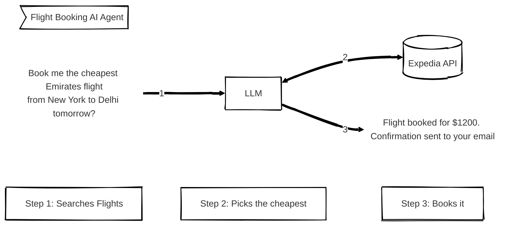
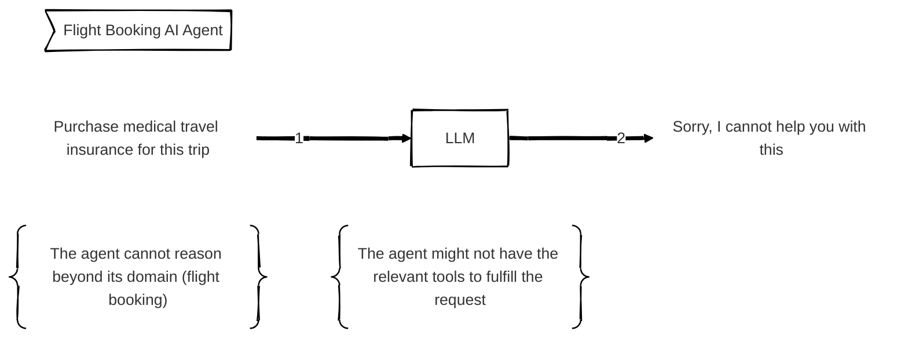

# What Is It?

[^1][^2]
It is a system that:

1. Takes input (text, image, audio, etc.)
2. Thinks or reasons about the input
3. **Acts** to complete a task.

# Common Components

[^3]

## Model

Typically an LLM combined with domain specific training and enterprise data grounding (RAG).

## Tools

[^4]
A **tool** is an executable function with defined inputs, outputs, and side effects. It performs a dynamic operation like web search, database query or an API call.

## Instructions

This includes system or rule [prompts](Notes/Prompt%20Engineering.md#Types%20of%20Prompts) as well as predefined rules and skills that <mark style="background: #ADCCFFA6;">guide _how_ the model behaves and makes decisions</mark>.

- [I] Think declarative programming, instead of procedural programming.

> [!example]
>
> - **Role Definition** :_You are a professional, calm customer support assistant._
> - **Guardrails**: _Never reveal internal pricing or confidential data._
> - **Prioritization**: _If a user appears angry, escalate to a human immediately._

Its ability to reason means that:

1. It can break down a task into subtasks and perform step-by-step tasks i.e. it orchestrates a workflow.
2. Reflect on outcomes and adapt to improve them in the future.<mark style="background: #FF5582A6;">(Specific to Agentic AI Agents).</mark>

> [!note]
> Agents that are agentic in nature, would use more sophisticated [prompting techniques](Notes/Prompt%20Engineering.md#Prompting%20Techniques) like ReAct to enable deeper insights and decision making as opposed to simple AI Agents which may use simpler techniques like CoT or Few shot.

## [Memory](Notes/Generative%20AI.md#Memory%20Vs%20Knowledge)

Short-term memory tracks active conversations, while long-term memory and vector databases store historical context and factual knowledge via Retrieval-Augmented Generation (RAG).

# Key Characteristics

- [k] Requires minimal to no human intervention, once it starts working.
- [k] Built for **narrow, well-defined tasks** which <mark style="background: #ADCCFFA6;">execute repeatable operations within a fixed domain</mark>

> Ex: <mark style="background: #BBFABBA6;">Email filtering, database querying, calendar coordination.</mark>

- [k] Operates reactively with limited autonomy and predefined tools.
  - [c] It can only respond to user input and <mark style="background: #FFB8EBA6;">cannot initiate action on its own</mark>.
  - [c] Automation is limited as, an agent can only make decisions within the boundaries of its assigned task. Ex: <mark style="background: #BBFABBA6;">_An email writing agent can decide 'how to write' an email but it cannot decide to 'send the email'_</mark>.
  - [c] It can only use predefined tools i.e. it cannot discover new tools or synthesize a workaround if its current tools fail.

[^1]: [Agentic AI vs AI Agents: Key Differences Explained](https://www.moveworks.com/us/en/resources/blog/agentic-ai-vs-ai-agents-definitions-and-differences)

[^2]: [Generative AI vs AI agents vs Agentic AI - YouTube](https://www.youtube.com/watch?v=O2gerCxEXvc)

[^3]: [Inside the Machine: The Three Core Components of Every AI Agent | by Raghunandan Gupta | Medium](https://raghunitb.medium.com/inside-the-machine-the-three-core-components-of-every-ai-agent-41f800a3d7e1)

[^4]: [Skills vs Tools for AI Agents: Production Guide](https://www.arcade.dev/blog/what-are-agent-skills-and-tools/)
