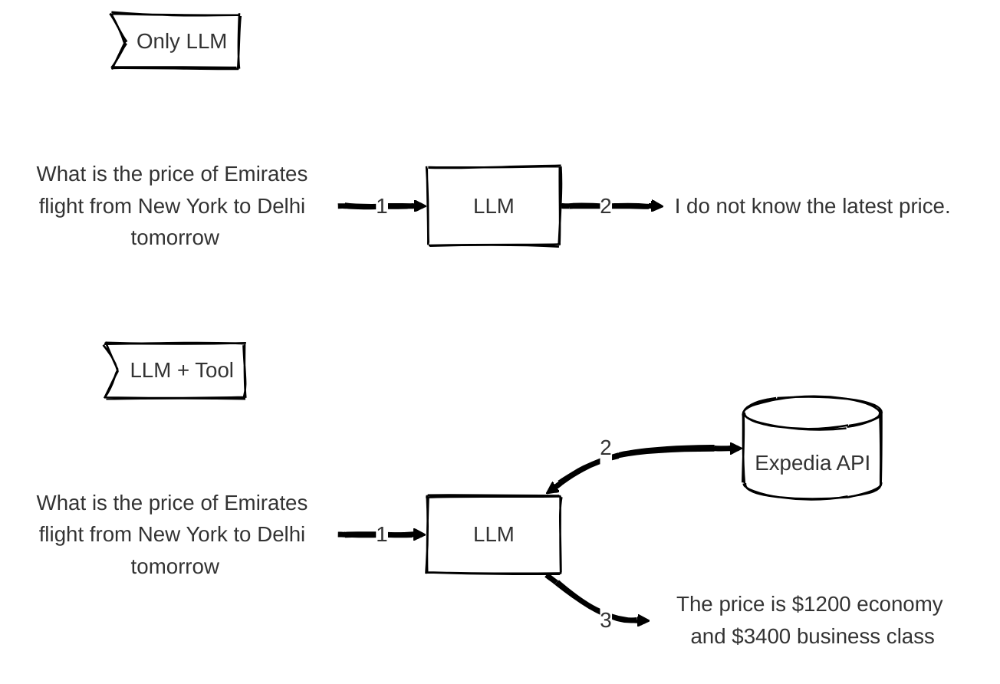

It is a type of AI that creates new content, such as text, images, or audio based on patterns learned from existing data.[^1]

- [c] Knowledge freshness depends on training cutoff.

To overcome this limitation, LLMs can use tools (web search, APIs, code interpreter etc.) to ground their predictions.



# Memory Vs Knowledge

[^2] [^3]
**Knowledge**: External reference material (RAG database, company policies) and pre-existing data (training data) that <mark style="background: #ADCCFFA6;">remains uniform across all users. </mark>

- [*] It provides a fixed ground truth that is <mark style="background: #FFB8EBA6;">available across different chats.</mark>

**Memory**: It is unique to every user/chat.

1. **Context Window (Short term memory)**: It holds a limited amount of tokens that a model uses to track the conversation flow. Once this window is exceeded, earlier parts of the conversation are forgotten.
   - [!] Memory lasts for the active session only!
2. **Long term memory**: User preferences or history is stored externally as embeddings or structured records and <mark style="background: #FFB8EBA6;">reused across multiple chat sessions.</mark>

> [!Example]
> **User query**:
>
> ```
> Can you check if my upcoming flight to London fits our company travel budget rules?
> ```
>
> **AI workflow (LLM + Tool + Memory/External Knowledge) search process**:
>
> 1. It first **checks memory** to recall user specific context.
>    _<mark style="background: #BBFABBA6;"> User role: VP of Engineering, Home airport: SFO, Booking preference: Delta or British Airways. Upcoming itinerary draft: SFO to LHR on Oct 12, business class fare quoted at \$4,800</mark>_
> 2. Next, it checks its knowledge base.
>    _Here, it uses a tool to query the company's internal knowledge/database to get the result:<mark style="background: #BBFABBA6;"> Executive tier (VP and above) allows Business Class on international flights over 6 hours, capped at \$5,000 per long-haul segment.</mark>_
> 3. Lastly, it combines the memory and the knowledge output to generate the final response. <mark style="background: #BBFABBA6;">_Your flight from SFO to LHR ($4,800 in Business Class) is **within company policy**. Under our executive travel guidelines, VPs are approved for business class on international routes over 6 hours up to a $5,000 limit. Would you like me to go ahead and save this quote to your expense draft?_</mark>

# Limitations

[^4]

- [c] **Hallucination**: LLMs can fabricate facts with high confidence because they are trained to <mark style="background: #ADCCFFA6;">predict statistically likely word sequences</mark> rather than the verified truth.
- [c] **Stale data**: Language models rely on static snapshots of training data that freeze at a specific cutoff point, leaving them without inherent knowledge of events or information occurring after that date.
- [c] **Domain-Specific Expertise:** Most general-purpose models struggle with specialized or proprietary knowledge, requiring [context engineering](Notes/Context%20Engineering.md) to supply precise external data for accurate domain-level reasoning.
- [c] **Context drift**: As information passes through sequential [prompts](Notes/Prompt%20Engineering.md), tools, or [agents](Notes/AI%20Agent.md), subtle errors, omissions, or distortions can accumulate, gradually pulling the overall system output away from the original context and intent.
- [c] **Lost in the middle effect**: <mark style="background: #FFB8EBA6;">LLMs pay more attention to information at the beginning and end of long prompts while neglecting content in the middle</mark>, which [context engineering](Context%20Engineering.md) must solve for accurate responses.

# Adapting GenAI Models

[^5]

## [Context Engineering](Context%20Engineering.md)

[^6]

- [*] <mark style="background: #BBFABBA6;">Lower cost and effort</mark>
  It is about making decisions regarding what context a model uses and what it doesn't use at every step.

> [!FAQ] What is meant by context?
> It can include:
>
> 1. [[Prompt Engineering#System Prompts|System prompts]]
> 2. Tools
> 3. Retrieved facts
> 4. Long term memory
> 5. [User prompts](Notes/Prompt%20Engineering.md#Contextual%20Prompts)

## Fine-Tuning

[^7]

- [*] <mark style="background: #BBFABBA6;">Higher cost and effort</mark>
  Adapt the base model by training it on a smaller, domain-specific dataset.
- [?] **When to fine tune?**

1. **Real-time latency**: If you require low-latency responses (e.g., voice agents) that frontier reasoning models cannot provide due to their "thinking time".
2. **Distillation:** If you want to transfer the reasoning capabilities of a large, high-quality model to a smaller, more efficient one.
3. **Reinforcement Fine-Tuning (RFT):** If you have a task with a definitive right answer where you want to reward the model for high-scoring outputs

## Practical Framework

1. **Start with a base model**
2. **Use RAG:** If you need the model to reference _fresh or proprietary knowledge_
3. **Use skills and tools**: If you need to add _procedural knowledge_ (how to perform specific tasks or use specific tools).
4. **Reach for Fine-Tuning:** Only consider fine-tuning if you hit a specific **bottleneck** that the techniques above cannot solve

[^1]: [Generative AI vs AI agents vs Agentic AI - YouTube](https://www.youtube.com/watch?v=O2gerCxEXvc)

[^2]: [Agent Knowledge vs Memories: Understanding the Difference - DEV Community](https://dev.to/bobur/agent-knowledge-vs-memories-understanding-the-difference-4pgj)

[^3]: [Do Large Language Models have Memory? | by Edgar Bermudez | about ai | Medium](https://medium.com/about-ai/do-large-language-models-have-memory-f5f86405ffd3)

[^4]: [Limitations of generative AI](https://livebook.manning.com/book/context-engineering/chapter-1/v-2/point-21582-75-79-0)

[^5]: [Training: Generative AI Fundamentals | Databricks](https://www.databricks.com/resources/learn/training/generative-ai-fundamentals)

[^6]: [Context engineering explained: What every AI developer should know - YouTube](https://www.youtube.com/watch?v=BBPQYtR7oUk)

[^7]: [Is Fine-Tuning Still Needed? LLMs, RAG, & LoRA - YouTube](https://www.youtube.com/watch?v=-W2JdSl1v48)
